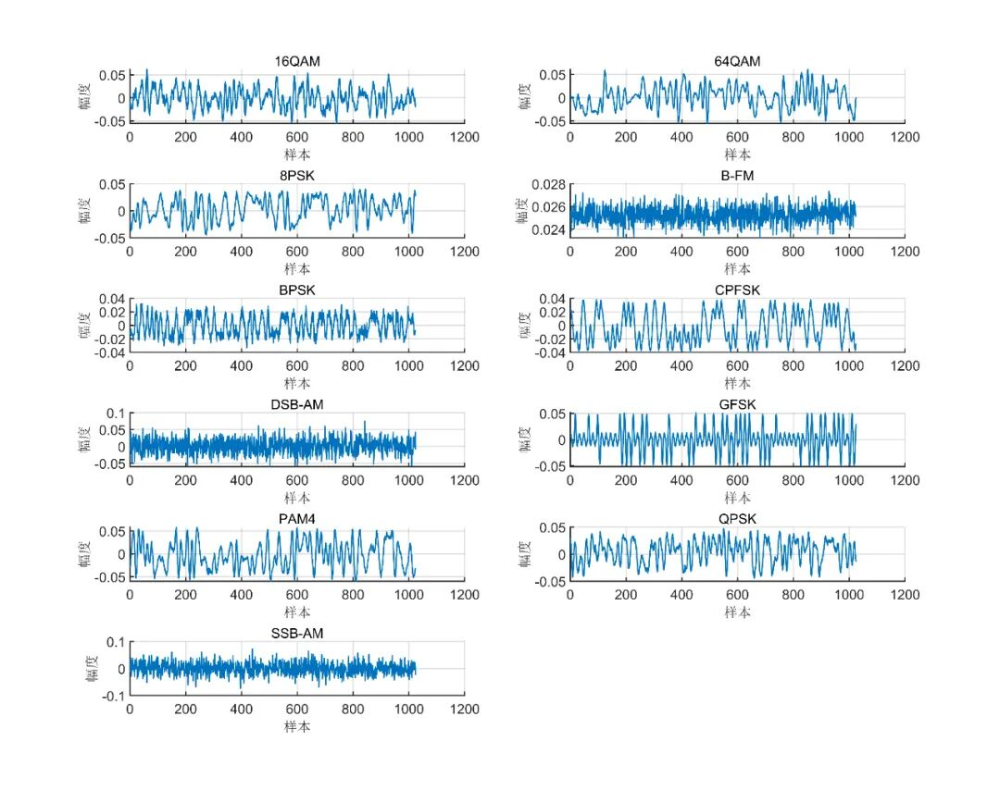
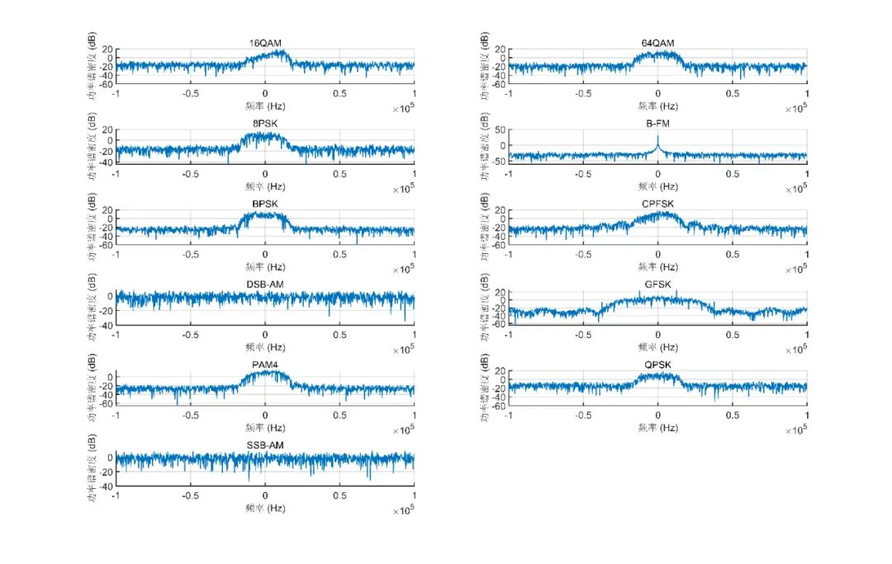
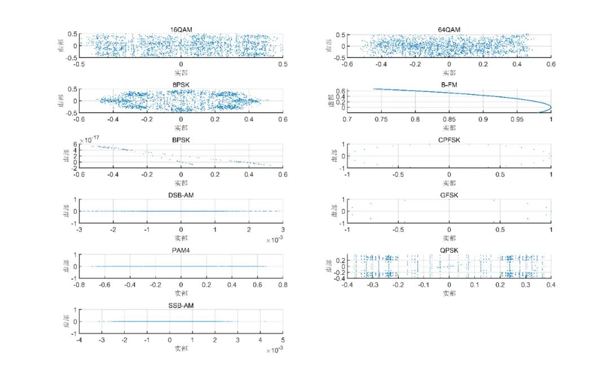
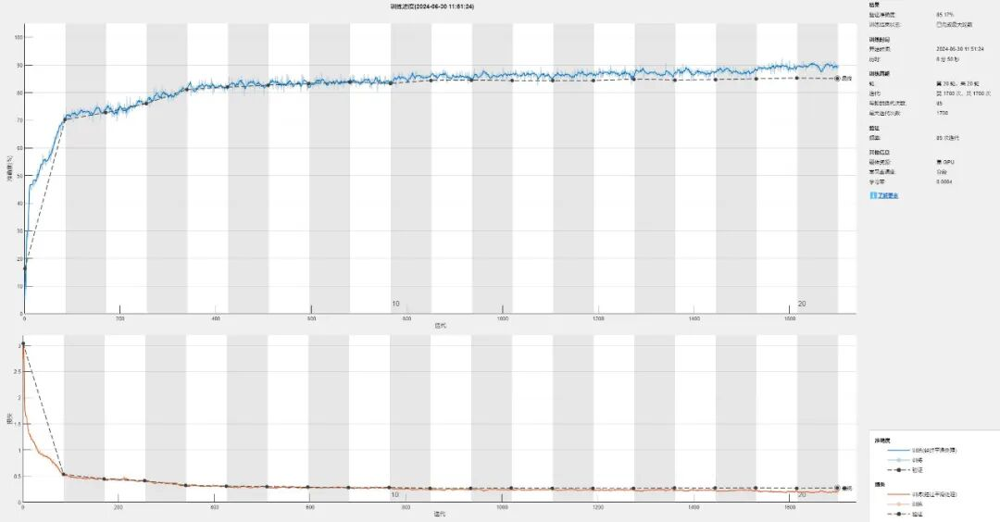
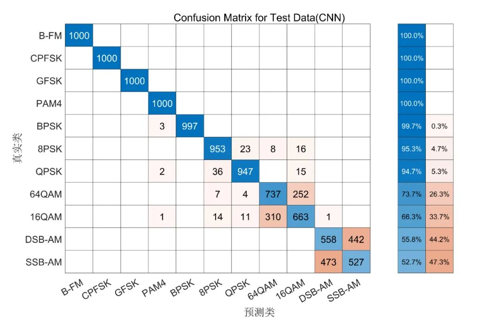
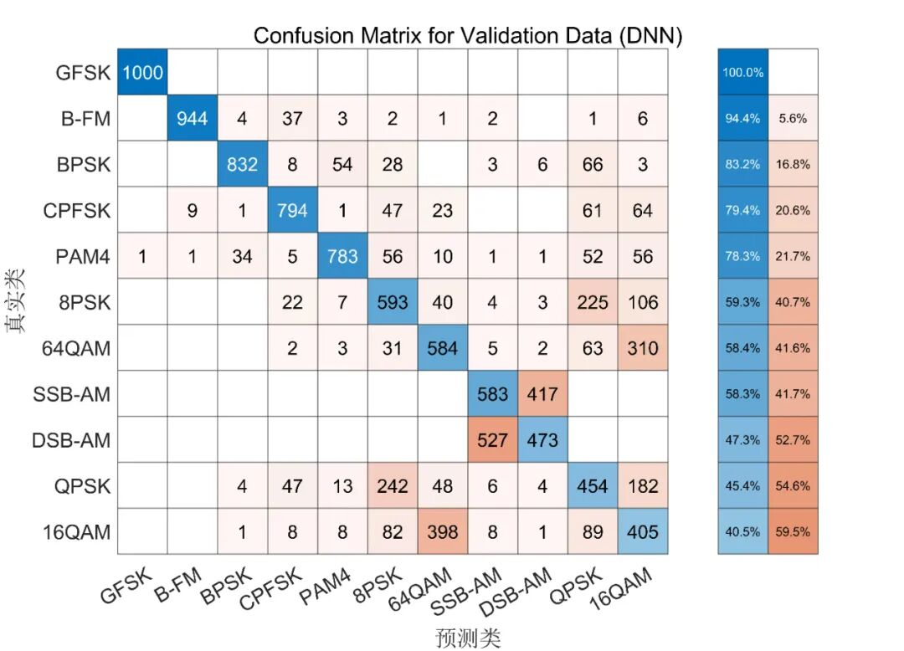
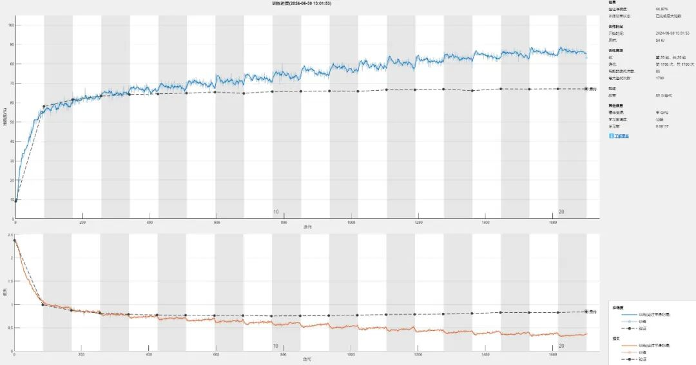
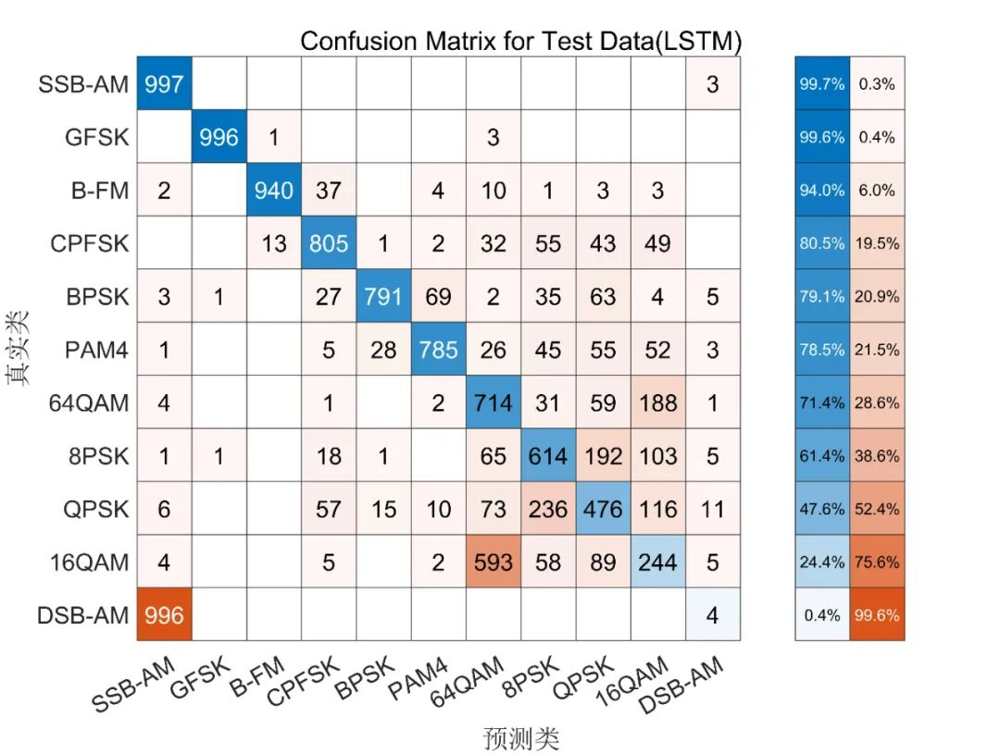
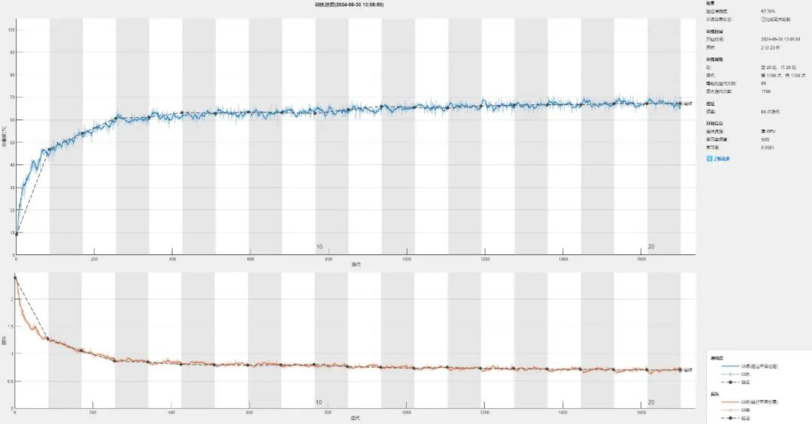

# [Modulation Identification] Modulation Style Recognition Based on CNN, DNN, RNN [Attached MATLAB Code]

These codes can be run in MATLAB to generate BPSK, QPSK, 8PSK, 16QAM, 64QAM, PAM4, GFSK, CPFSK, B-FM, DSB-AM and SSB-AM signals.
You can run show_signal.m to view the waveform, spectrum and constellation diagram of generated signals.
The interference options can be freely adjusted in the "Generat_Frames_Optional.m" file.
The design and training of the three models are implemented in NET_model_CNN.m, NET_model_DNN.m, and NET_model_RNN.m files.
Finally, you can run Evaluate_Trained_network.m to evaluate the training effect.
Of course, you can also design your own better algorithm to implement it. This project is a very crude algorithm.
Simulation results

## Images

<!-- PAYMENT_BLOCK -->

## Get this dataset

- Payment link (Stripe): [Buy now](https://buy.stripe.com/3cs8yP7sY87d0vu9AB)
- Payment QR code: 

<!-- /PAYMENT_BLOCK -->
